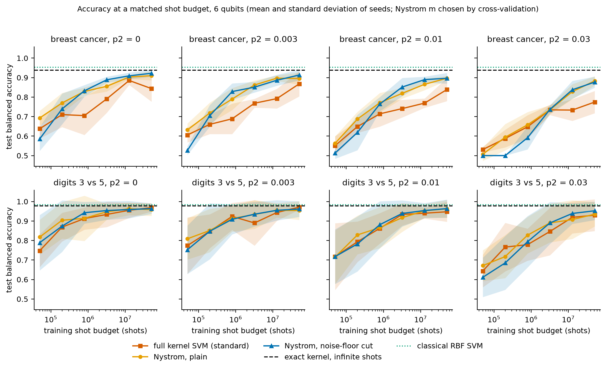
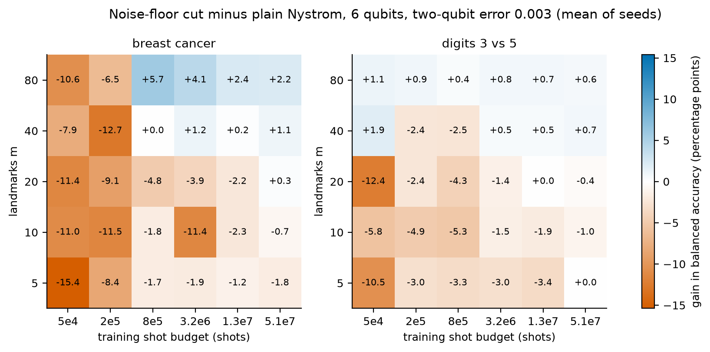
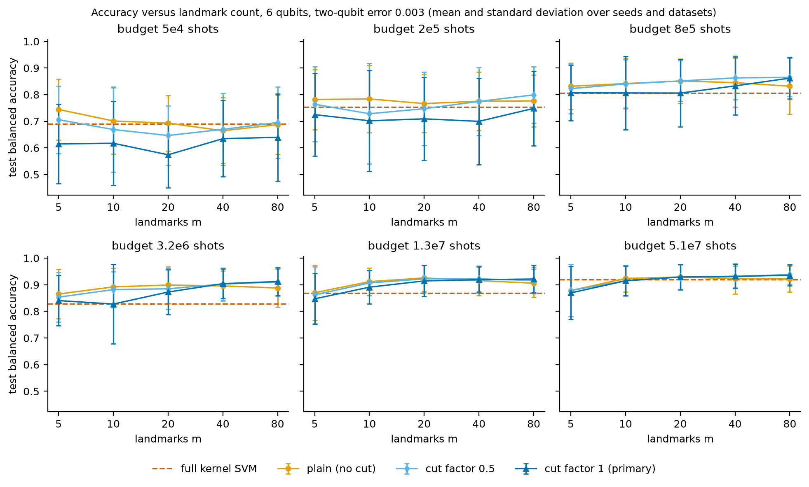
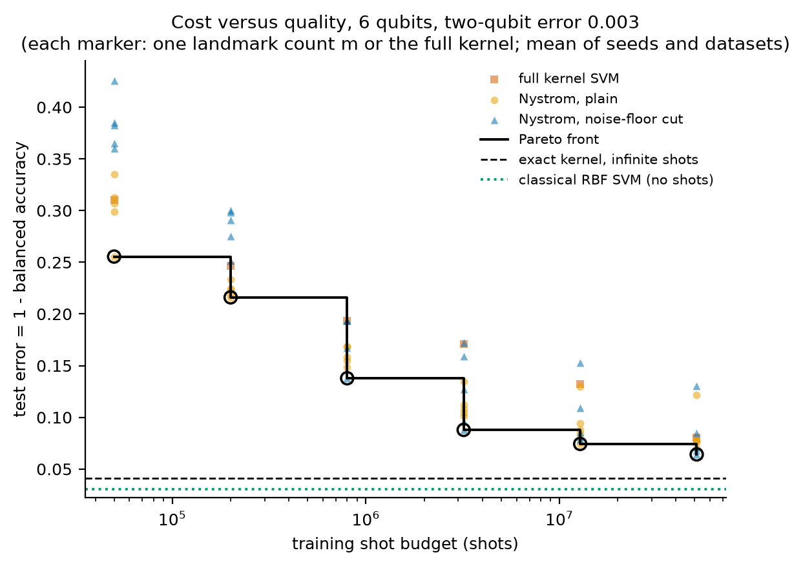
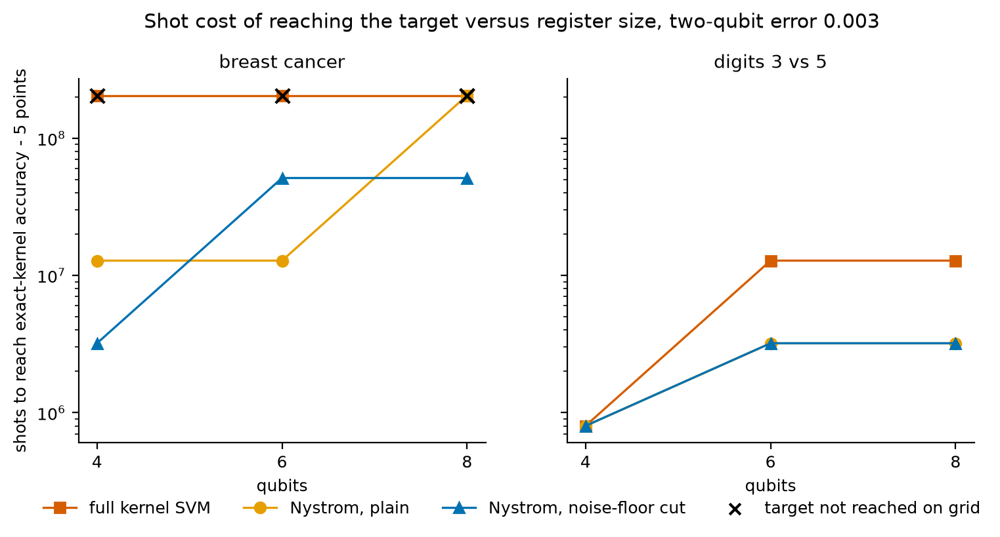

# Shot-Budgeted Nystrom Quantum Kernels: Landmark Count, Shot Noise and a Spectral Noise-Floor Cut

[](LICENSE)
[](pyproject.toml)
[](https://github.com/pradeepdegalaroyal/shot-budget-nystrom-quantum-kernel-noise-floor/actions/workflows/ci.yml)

**Abstract.** A fidelity-kernel quantum support vector machine (SVM) needs N(N-1)/2 kernel entries, and on a quantum processing unit (QPU) every entry costs shots; a Nystrom landmark approximation cuts the entry count but has not been analysed in units of shots. This simulation study (4 to 8 qubits, 160 training points, 2 datasets, 5 seeds) charges every shot, compares the full-kernel SVM, plain Nystrom and a Nystrom variant with a spectral cut at the shot-noise floor, and sweeps two-qubit gate error. At matched shot budgets, plain Nystrom with the landmark count chosen by cross-validation (CV) was never significantly worse than the full-kernel SVM and was significantly better in 9 of 36 cells; the pre-specified noise-floor cut did not help, and the quantum kernel did not beat a tuned classical radial basis function (RBF) SVM.

## Summary of results

Six qubits, two-qubit depolarising error 0.003, test balanced accuracy, mean ± standard deviation over 10 (dataset, seed) units. Landmark count m is chosen by training CV only. Source: `results/headline_table.csv`.

| Method (training shots) | 5.0e4 | 2.0e5 | 8.0e5 | 3.2e6 | 1.28e7 | 5.12e7 |
|---|---|---|---|---|---|---|
| Full kernel SVM (standard quantum baseline) | 0.690 ± 0.134 | 0.754 ± 0.119 | 0.806 ± 0.142 | 0.829 ± 0.102 | 0.868 ± 0.091 | 0.920 ± 0.070 |
| Nystrom, plain, CV-selected m | 0.720 ± 0.119 | 0.785 ± 0.108 | 0.851 ± 0.087 | 0.898 ± 0.064 | 0.926 ± 0.040 | 0.924 ± 0.049 |
| Nystrom, cut factor 0.5 (exploratory) | 0.717 ± 0.119 | 0.796 ± 0.113 | 0.869 ± 0.076 | 0.903 ± 0.061 | 0.911 ± 0.053 | 0.938 ± 0.043 |
| Nystrom, cut factor 1 (pre-specified) | 0.639 ± 0.146 | 0.776 ± 0.127 | 0.869 ± 0.072 | 0.893 ± 0.064 | 0.921 ± 0.054 | 0.937 ± 0.041 |

Shot-free references (same inputs): exact-kernel SVM with infinite shots 0.959 ± 0.027, tuned classical RBF SVM 0.969 ± 0.019, random forest 0.955 ± 0.024.



*Figure 2. Takeaway: at matched shots the landmark models sit above the full-kernel SVM across most of the budget range and noise levels, and every quantum curve stays below the classical RBF SVM line.*

## What is new here

* Every shot used to build the quantum kernel is charged, so the full kernel and the landmark kernels are compared at the same training shot budget rather than the same number of samples or entries.
* The landmark count m is shown to have a budget-dependent interior optimum (plain Nystrom: best m of 5, 10, 20, 20, 20, 20 over the six budgets), which a fixed-budget accuracy table cannot reveal.
* A spectral cut whose threshold is set by the shot-noise level (no tuned constant) is tested against plain Nystrom with a pre-registered factor, and its failure at the pre-specified factor is reported with an ablation over the factor.
* The gate-noise model is validated against the Aer density-matrix simulator and its bias is reported.

## Method

```mermaid
%%{init: {'theme': 'base', 'themeVariables': {'primaryColor': '#ffffff', 'primaryTextColor': '#000000', 'primaryBorderColor': '#000000', 'lineColor': '#000000', 'secondaryColor': '#ffffff', 'tertiaryColor': '#ffffff', 'background': '#ffffff', 'noteBkgColor': '#ffffff', 'noteTextColor': '#000000', 'actorBkg': '#ffffff', 'actorBorder': '#000000', 'actorTextColor': '#000000', 'signalColor': '#000000', 'signalTextColor': '#000000', 'labelBoxBkgColor': '#ffffff', 'labelTextColor': '#000000', 'clusterBkg': '#ffffff', 'clusterBorder': '#000000'}}}%%
flowchart LR
    subgraph QL["Quantum lane: simulated device"]
        Q1["feature_map.py<br/>ZZ feature map, 2 repetitions,<br/>one qubit per PCA component"]
        Q2["shots.py<br/>compute-uncompute overlap,<br/>shots per entry = budget / entries"]
        Q3["hardware.py<br/>CX count G = 8 x n-1,<br/>fidelity f = 1-p2 to the power G"]
    end
    subgraph NL["Nystrom lane: landmark kernel"]
        N1["nystrom.py<br/>m landmarks,<br/>entries = m x m-1 / 2 + N-m x m"]
        N2["Eigen-split of landmark block,<br/>drop eigenvalues below<br/>c x 2 x sigma x sqrt m"]
        N3["models.py<br/>linear SVM, C and m by<br/>3-fold cross-validation"]
    end
    subgraph CL["Classical lane: references"]
        C1["Full kernel SVM,<br/>positive-semidefinite projection"]
        C2["RBF SVM and random forest,<br/>no shots"]
    end
    E["analysis.py<br/>test balanced accuracy at equal shots,<br/>paired over 2 datasets x 5 seeds"]
    Q1 --> Q2 --> Q3
    Q3 --> N1 --> N2 --> N3 --> E
    Q3 --> C1 --> E
    C2 --> E
    classDef bw fill:#ffffff,stroke:#000000,color:#000000,stroke-width:2px;
    class Q1,Q2,Q3,N1,N2,N3,C1,C2,E bw;
```

Legend: PCA = principal component analysis; CX = controlled-NOT gate; RBF = radial basis function; SVM = support vector machine; p2 = two-qubit depolarising probability; n = qubits; N = training points (160); m = landmarks; sigma = per-entry shot-noise standard deviation; c = cut factor.

A kernel entry is the probability of reading all zeros after the compute-uncompute circuit of the Qiskit ZZ feature map. The training shot budget is split evenly over the distinct entries each method needs (12,720 for the full kernel; 190 + 140 x 20 = 2,990 for m = 20); a gate-noise model turns the exact entry into a binomial count with an affine depolarising floor that the estimator inverts. Landmark features are `K_xm U_r L_r^(-1/2)`; the cut keeps eigenvalues above `c * 2 * sigma * sqrt(m)`, the spectral-norm scale of an m x m shot-noise matrix. Full details are in [`docs/METHOD.md`](docs/METHOD.md).

## Motivation

Kernel quantum machine learning (QML) avoids the trainability obstacles of variational circuits (Cerezo et al., 2022, digital object identifier (DOI) 10.1038/s43588-022-00311-3) but its cost grows quadratically with the training set. Recent applied work puts numbers on the problem: Dagli et al. (2027, DOI 10.1007/978-3-032-39763-8_20) report a quantum support vector machine (QSVM) at about 12,970 times the energy of a random forest with a lower F1 score, and Saberikamarposhti (2027, DOI 10.1016/j.future.2026.108884) uses a Nystrom approximation to reduce circuit evaluations and compares models at a matched sample budget. On hardware the billed quantity is the shot, and this study measures what the landmark idea is worth in that unit.

## Research gap

The supplied literature counts kernel entries or samples, not shots. With a fixed shot budget, more landmarks give a better kernel approximation but fewer shots per entry, and the Nystrom map divides by the square roots of the landmark-block eigenvalues, which shot noise corrupts first. The related-work table, the gap statement and the hypotheses are in [`docs/RESEARCH_GAP.md`](docs/RESEARCH_GAP.md); the standard baseline is the fidelity-kernel SVM of Schuld and Killoran (2019, DOI 10.1103/PhysRevLett.122.040504).

## Hypotheses and verdicts

Thresholds were fixed in `docs/RESEARCH_GAP.md` before the full run. Setting: 6 qubits, p2 = 0.003 unless stated.

| Hypothesis | Verdict | Evidence (file) |
|---|---|---|
| H1: plain Nystrom accuracy peaks at an interior m for at least 4 of 6 budgets | **Supported** | Best m is 5, 10, 20, 20, 20, 20 for the six budgets, so interior in 5 of 6; with cut factor 1 the best m is 80 at every budget (`results/h1_accuracy_by_landmark_count.csv`) |
| H2: cut factor 1 raises accuracy at m = 40 and 80 by at least 1.0 point (interval excludes 0) | **Rejected** | Gain -0.733 ± 1.055 points (10 units). Post hoc: factor 0.25 gives +1.204 ± 0.344 and factor 0.5 gives +1.310 ± 0.560; factor 2 gives -9.115 ± 1.478 (`results/h2_cut_gain_large_m.csv`) |
| H3: cut-Nystrom beats the full kernel at the three smallest budgets (paired 95% interval above 0) | **Rejected as specified** | Differences -5.0 ± 3.7, +2.2 ± 6.0, +6.2 ± 7.5 points at 5.0e4, 2.0e5, 8.0e5 shots. Significant gains appear instead at 3.2e6 (+6.4 ± 3.9) and 1.28e7 shots (+5.3 ± 3.8) (`results/contrasts.csv`) |
| H4: gate noise raises the shots needed to come within 2 points of the exact kernel | **Partly supported, coarse** | The 2-point target is reached in only 3 of 12 groups for the full kernel and plain Nystrom and in 6 of 12 for cut factor 1; with the looser 5-point target the budget rises with p2 on digits (cut factor 1: 8.0e5, 3.2e6, 3.2e6, 1.28e7 shots at p2 = 0, 0.003, 0.01, 0.03) but the grid step of 4 hides a 2.2-fold variance inflation (`results/shots_to_target.csv`, `results/target_reach_summary.csv`) |

## Results

Pooled paired comparison over all 36 cells (6 configurations of qubits and p2, 6 budgets; `results/contrast_sign_counts.csv`):

| Model versus | Cells significantly better | Cells significantly worse | Mean difference (points) |
|---|---|---|---|
| Plain Nystrom versus full kernel | 9 | 0 | +3.366 |
| Cut 0.25 versus full kernel (post hoc) | 18 | 0 | +3.953 |
| Cut 1 (pre-specified) versus full kernel | 13 | 2 | +2.497 |
| Cut 2 versus full kernel | 7 | 14 | -3.046 |
| Cut 1 versus plain Nystrom | 2 | 5 | -0.869 |
| Cut 0.25 versus plain Nystrom (post hoc) | 5 | 0 | +0.587 |



*Figure 1. Takeaway: the pre-specified cut (factor 1) loses up to 15 points at small budgets and gains a few points mostly at m = 80, chiefly on breast cancer with 8.0e5 shots or more.*



*Figure 4. Takeaway: plain Nystrom has a flat-to-peaked profile whose optimum moves from m = 5 to m = 20 as the budget grows, while the cut-factor-1 variant improves with m (its best m is 80 at every budget).*



*Figure 3. Takeaway: no full-kernel configuration lies on the cost-quality front (`results/pareto_front.csv`); the front is made of plain Nystrom at 5.0e4, 2.0e5 and 1.28e7 shots and cut-Nystrom at m = 80 at 8.0e5, 3.2e6 and 5.12e7 shots. The best m is picked on test accuracy here, so the front is optimistic.*



*Figure 5. Takeaway: on digits 3 versus 5 the full kernel needs 1.28e7 shots at 6 and 8 qubits to come within 5 points of the exact kernel, whereas plain Nystrom needs 3.2e6; on breast cancer the full kernel does not reach the target within 5.12e7 shots at any size (censored values drawn as crosses at the top; `results/shots_to_target.csv`).*

Landmark-block spectrum at m = 80, 6 qubits, p2 = 0.003 (`results/rank_and_noise_floor.csv`): the plain pseudo-inverse keeps on average 42.3 of 80 eigenvalues at 5.0e4 shots and 47.4 at 5.12e7; cut factors 0.5, 1 and 2 keep 18.4, 3.9 and 1.1 at 5.0e4 shots, and 25.8, 12.8 and 9.4 at 5.12e7. The single-entry shot-noise standard deviation falls from 0.208 (5 shots per entry) to 0.0066 (5,355 shots per entry).

Simulator and noise-model checks (`results/aer_validation.json`): the numpy statevector kernel agrees with Qiskit to 4.2e-15. The global-depolarising model underestimates the all-zero probability of the Aer density-matrix run with local two-qubit depolarising errors by 0.0034 on average at p2 = 0.003 (root-mean-square (RMS) 0.0050), 0.0092 at 0.01 (RMS 0.0134) and 0.0153 at 0.03 (RMS 0.0221, against a mean probability of 0.0793).

## Discussion

The robust finding is modest: plain Nystrom with m chosen by CV is, in these simulations, at least as good as the full-kernel SVM at the same shot budget and often better (mean +3.366 points over 36 cells, 9 significantly better, none significantly worse), and a prediction needs m kernel entries per test point instead of 160. The landmark count has a real interior optimum that moves with the budget (H1).

The mechanism proposed in the research gap is not supported. If amplification of noisy small eigenvalues were the dominant failure of plain Nystrom, cutting them at the estimated noise floor would help; with the pre-specified factor 1 it hurt at small budgets (-8.1 ± 3.2 points against plain at 5.0e4 shots) and a larger factor was clearly worse. Smaller factors (0.25 and 0.5) gave +1.2 to +1.3 points at m = 40 and 80, but these factors were chosen after seeing the ablation and the gain over plain Nystrom is statistically visible in only 5 of 36 cells, so it is a lead for a replication, not a result. A plausible reading, untested here, is that the cross-validated linear SVM already damps the amplified directions and that the low-rank projection itself is what denoises the kernel.

The quantum kernel does not beat the classical baselines: the exact-kernel SVM (0.959 ± 0.027) is below the tuned RBF SVM (0.969 ± 0.019) pooled over datasets, and no claim of quantum advantage is made. The comparison concerns cost at fixed quality of a quantum method against another quantum method, not quantum against classical.

## Limitations

* Simulation only; at most 8 qubits, 160 training points, two small datasets, 5 seeds (10 paired units). No correction for multiple comparisons across the 36 cells.
* The angle scale, chosen by exact-kernel CV from {0.025, 0.05, 0.1, 0.2}, was the smallest value in 52 of 60 cells, i.e. at the edge of the grid. These kernels are smooth and effectively low rank, which favours a landmark approximation; harder, more concentrated kernels may behave differently. The grid was not extended in this study.
* Gate noise is a global depolarising model for two-qubit gates only; single-qubit and readout errors are absent, and the model is biased low against Aer by up to 0.0153 in the all-zero probability.
* Test kernel rows use the same shots per entry as training and are not charged to the budget; the full kernel could use support vectors only at prediction, which was not exploited.
* The SVM parameter C is chosen by CV on features that share the same noisy landmark estimates across folds.
* The shots-to-target metric is right-censored and has a grid step of 4; the cut factors other than 1 are post hoc.

## Future work

On hardware the same protocol applies directly: the compute-uncompute circuit has 8(n-1) CX gates for the ZZ map with linear connectivity, the calibrated survival factor f replaces the model, and shots are split over m landmark rows instead of N. Next steps are a wider angle-scale grid and concentrated kernels, leverage-score or k-means landmark selection, error-mitigated entries, a gradient-trained variational model (Mitarai et al., 2018, DOI 10.1103/PhysRevA.98.032309) charged at equal shots, and a PennyLane port of the circuit layer. These steps address scalable, shot-efficient training of QML models with classical baselines.

## Reproducibility

```bash
pip install -r requirements.txt && pip install -e . --no-deps
python experiments/run_all.py            # full study: 60 cells, 4 workers, 359 s total (338 s simulation)
python experiments/run_all.py --quick    # smoke run, about 30 s, writes to a temporary directory
python experiments/run_all.py --reanalyse  # rebuild tables and figures from results/raw_cells.csv
pytest -q                                # 9 tests
```

Run recorded in `results/run_meta.json`: Windows 11, Python 3.11.9, 16 central processing unit (CPU) threads (4 workers used), no graphics processing unit (GPU) used, numpy 2.2.6, pandas 2.3.3, Qiskit 2.4.2, Qiskit Aer 0.17.2. Seeds 0 to 4 control the data split, the landmark permutation and the shot noise. Raw per-cell results are in `results/raw_cells.csv`.

## Project structure

```
src/nystrom_qkernel/   feature_map, shots, hardware, nystrom, models, data, experiment, analysis, plots, validation
experiments/run_all.py one-command reproduction (--quick, --reanalyse)
tests/test_core.py     simulator, shot model, Nystrom features, selection protocol
docs/                  RESEARCH_GAP.md (related work, hypotheses), METHOD.md
results/               comma-separated values (CSV) tables and JavaScript Object Notation (JSON); figures/ holds fig1 to fig5 (200 dpi)
.github/workflows/     continuous integration: pytest and the quick run on ubuntu-latest
```

## Related work by the author

* [label-scarce-fraud-qml-vs-classical](https://github.com/pradeepdegalaroyal/label-scarce-fraud-qml-vs-classical): fidelity-kernel SVM and data re-uploading circuit against tuned classical models; this study adds the shot-cost axis to the kernel side.
* [anytime-valid-shot-stopping-quantum-circuit-tests](https://github.com/pradeepdegalaroyal/anytime-valid-shot-stopping-quantum-circuit-tests): when a shot-based circuit test can stop; a complementary view of shot economy.

## Citation

```bibtex
@software{degala_shot_budget_nystrom_quantum_kernel_2026,
  author   = {Degala, Chenchupradeep},
  title    = {Shot-Budgeted Nystrom Quantum Kernels: Landmark Count, Shot Noise and a Spectral Noise-Floor Cut},
  year     = {2026},
  version  = {0.1.0},
  url      = {https://github.com/pradeepdegalaroyal/shot-budget-nystrom-quantum-kernel-noise-floor},
  license  = {MIT}
}
```

MIT (Massachusetts Institute of Technology) license (`LICENSE`). Machine-readable citation metadata: `CITATION.cff`.
